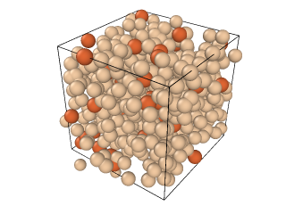

# Explanation of the RMC_POT cfg file


This page describes the RMC_POT Version 3 `.cfg` configuration-file format, including its header and atomic coordinates.



---

## Example: excerpt from aaa.cfg

The following is an excerpt from a typical cfg file. The first line must be preserved exactly.


aaa.cfg
```text
 (Version 3 format configuration file) !file created by SimpleCfg::save !
comment sio2


               0               0               0               0               0               0               0               0               0               0               0               0               0 moves gen, tried, acc, pot-acc, swap-gen, swap-acc, E0shift-gen, E0shift-acc, I(Q)mu-gen, I(Q)mu-acc, f'shift-gen, f'shift-acc, goodnonlinreg
          0              configurations saved
 
        300 molecules of all types
          3 types of molecules 
          1 is the largest number of atoms in a molecule 
          0 Euler angles are provided 
 
          F (box is cubic)	
            Defining vectors are: 
              7.635000   0.000000   0.000000
              0.000000   7.635000   0.000000
              0.000000   0.000000   7.635000

        100 molecules of type  1
          1 atomic sites 
              0.000000   0.000000   0.000000
 
        160 molecules of type  2
          1 atomic sites 
              0.000000   0.000000   0.000000
 
         40 molecules of type  3
          1 atomic sites 
              0.000000   0.000000   0.000000
 
 0.469499871368697  0.860252930085134  0.143086911460380
 0.506517212128356  0.782365058978389  -0.044207465828422
 0.424472315756385  -0.948087206561890  0.159658069155206
 0.519361825199738  0.779885605592665  0.290516312927309
 0.447290765121153  -0.667661128775380  0.036773942632613
 0.454085926915521  0.047929672102161  -0.361803986548788
 0.382807239777341  -0.107567570857891  -0.467392567413229
 0.322093601270465  0.152408219423707  -0.261319106024885
 0.617544006208252  0.075438279462999  -0.325725383837590
 0.032760774708579  0.186415932416503  -0.177798618166339
 0.899782755769483  0.086198503510151  0.756794255625409
```

## Explanation of each section (in order)

1. First line (required)

    The first line is
    ```{code}
     (Version 3 format configuration file) !file created by SimpleCfg::save !
    ```
    This line must be copied without modification.

2. Comment line
    
    ```{code}
    comment sio2
    ```
    This is a comment.

3. Total count and molecular overview (when molecular information is used)
    
    Molecular information starts at line 8.
    ```{code}
    300 molecules of all types
    ```
    In this example, RMC is performed with atomic information only, without molecular information.
    Enter the number of atoms here.

4. Number of types, molecular size, and Euler-angle flag

    ```{code}
    3 types of molecules 
    1 is the largest number of atoms in a molecule 
    0 Euler angles are provided 
    ```
    Specify the number of atomic species. There are three species in this example, so the value is 3.
    Because molecular information is not used, the second line is 1 and the third line is 0.

5. Cell (box) information

    ```{code}
      F (box is cubic)	
        Defining vectors are: 
          7.635000   0.000000   0.000000
          0.000000   7.635000   0.000000
          0.000000   0.000000   7.635000
    ```
    For a cubic cell of side length L, enter L/2.
    In this example, 15.27 Å / 2 = 7.635 Å.

6. Counts of each atomic (molecular) species and atomic sites

    Next come the counts for each atomic species.
    ```{code}
    100 molecules of type  1
      1 atomic sites 
          0.000000   0.000000   0.000000
    
    160 molecules of type  2
      1 atomic sites 
          0.000000   0.000000   0.000000
    
     40 molecules of type  3
      1 atomic sites 
          0.000000   0.000000   0.000000
    ```
    This example has 100 atoms of species 1, 160 of species 2, and 40 of species 3.
    The atomic coordinates that follow must be listed in species order: 1, 2, then 3.

7. Coordinate block (end of file)

    The atomic coordinates are written at the end.
    ```{code}
     0.469499871368697  0.860252930085134  0.143086911460380
     0.506517212128356  0.782365058978389  -0.044207465828422
     0.424472315756385  -0.948087206561890  0.159658069155206
     0.519361825199738  0.779885605592665  0.290516312927309
     0.447290765121153  -0.667661128775380  0.036773942632613
     0.454085926915521  0.047929672102161  -0.361803986548788
     0.382807239777341  -0.107567570857891  -0.467392567413229
     0.322093601270465  0.152408219423707  -0.261319106024885
     0.617544006208252  0.075438279462999  -0.325725383837590
     0.032760774708579  0.186415932416503  -0.177798618166339
     0.899782755769483  0.086198503510151  0.756794255625409
    ```
    Coordinates are expressed in the range (-1, 1), with the center of the cubic cell as the origin.
    In other words, the coordinates are scaled according to the cell size.
    For example, when L = 15.27 Å, coordinates (0.5, 0.5, 0.5) correspond to physical coordinates (3.8175 Å, 3.8175 Å, 3.8175 Å).
    ```{math}
    x_{\mathrm{center}} = x_{\mathrm{cfg}}\frac{L}{2}\\
    x_{\mathrm{corner}} = (x_{\mathrm{center}}+L/2)\bmod L\\
    x_{\mathrm{cfg}} = 2\frac{x_{\mathrm{center}}}{L}
    ```
    Therefore,
    Here $x_{\mathrm{center}}$ denotes Cartesian coordinates relative to the cell center, and $x_{\mathrm{corner}}$ denotes coordinates relative to a cell corner. When converting to VASP Cartesian coordinates, verify the POSCAR lattice vectors and origin convention.

           
---

## Practical notes / checklist

- Do not remove or modify the first (Version) line.
- Match the counts and ordering of “types”, “atomic sites”, and “molecules of type” to the specification of the cfg reader.
- List all coordinates for species 1 first, then species 2, and so on (as expected by many implementations).
- The Defining vectors in this example represent the half-side length $L/2$ of the cubic cell. Check the coordinate convention before applying this rule to other file formats.

---
