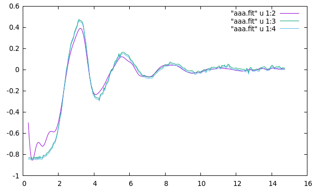
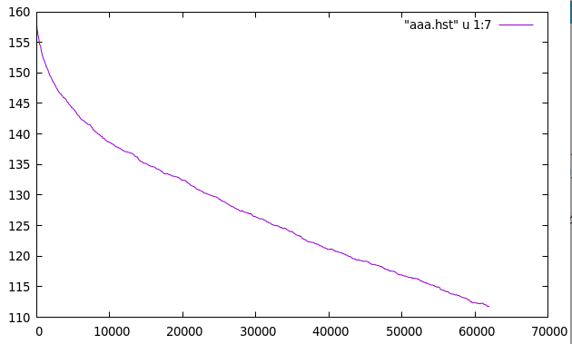
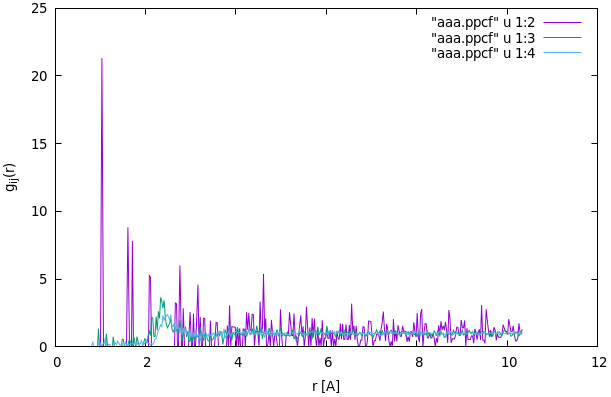
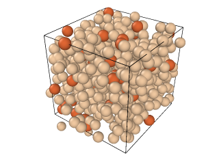

# RMC_POT output files (explained)

This document briefly explains the formats and interpretation of representative RMC_POT output files. It covers the following file types.

- .fit — fitting results for the structure factor S(Q) (or F(Q))
- .hst — chi-square values and fitting progress
- .ppcf — partial pair correlation functions gij(r) (PPCF)
- .cfg — atomic configuration file

---

## General notes
- Most outputs are human-readable, whitespace-delimited text. They may be converted to CSV or another format for visualization and analysis.
- Units: distances are usually given in ångströms (Å).
- Also consult the RMC_POT user guide: https://www.szfki.hu/~nphys/rmc++/RMC_POT_user_guide.pdf

---


## .fit file — fitting status for the structure factor S(Q)

The file compares calculated and experimental data. Its header indicates the types and numbers of datasets (for example, g(r), S(Q), and F(Q)).

aaa.fit
```text
Calculated and experimental total data for each data sets
0	 g(r) data sets
0	 S(Q) data sets
1	 F(Q) data sets
0	 F(g) data sets
0	 E(k) data sets

Total F(Q) for data set #1/1
Renormalization factor a=	1.000000e+00
Renormalization factor b=	-1.186518e+01
Renormalization factor c=	0.000000e+00
Renormalization factor d=	0.000000e+00
           Q	          F(Q) RMC++	       renorm exp. F(Q)	  original exp. F(Q)	          background
2.635850e-01	 -1.290579277856e+00	    -1.005258621913e+01	  1.812590000000e+00	 -1.186517621913e+01
2.812760e-01	 -1.294920422437e+00	    -1.052247621913e+01	  1.342700000000e+00	 -1.186517621913e+01
2.989660e-01	 -1.299385311315e+00	    -1.094524621913e+01	  9.199300000000e-01	 -1.186517621913e+01
   :                  :                      :                      :                      :
```

Meaning of the principal columns
- Q: scattering-vector magnitude (usually Å⁻¹)
- F(Q) RMC++: F(Q) calculated by RMC (the output column may be labeled F(Q))
- renorm exp. F(Q): experimental F(Q) after renormalization
- original exp. F(Q): original experimental F(Q) before correction
- background: background contribution (background correction)


From line 13 onward, the calculated and experimental F(Q) values are listed against Q.
```math
F(Q) = S(Q) - 1 
```
Note that the F(Q) used here is the commonly displayed structure factor S(Q) minus one.
When plotting the results, use
S(Q)=F(Q)+1
and plot the resulting S(Q).





Figure. Comparison of S(Q) for the RMC structural model and experimental S(Q) (two experimental curves are shown; they differ by correction).


For details, see the equations around (E3) in the user guide:
https://www.szfki.hu/~nphys/rmc++/RMC_POT_user_guide.pdf


# .hst file — chi-square values and fitting progress
```text
This file contains History data produced by History::save 
:
:
For F(Q) data set 1	F(Q) fitting was used

generated       	tried           	accepted        	time      	tried/gen       	acc/tried       	chi2_tot/data_point;       	chi2/F(Q)_set#1;           
               0	               0	               0	         0	        0.000000	        0.000000	1.578930954817895e+02      	4.578899768971894e+04      
              30	              17	              11	         0	        0.566667	        0.647059	1.574103409681942e+02      	4.564899888077633e+04      
              77	              39	              22	         0	        0.468085	        0.500000	1.569245983657412e+02      	4.550813352606496e+04      
             113	              62	              33	         0	        0.638889	        0.478261	1.567761016798288e+02      	4.546506948715034e+04      
             146	              80	              44	         0	        0.545455	        0.611111	1.563252734257866e+02      	4.533432929347811e+04      
             163	              91	              55	         1	        0.647059	        1.000000	1.562772215647136e+02      	4.532039425376695e+04      
             211	             116	              66	         1	        0.520833	        0.440000	1.560415962591003e+02      	4.525206291513910e+04      
             249	             142	              77	         1	        0.684211	        0.423077	1.557480271250309e+02      	4.516692786625896e+04       
  　　　　　　 :   　　         
  　　　　　　 :   　　          
           61999	           36721	            9713	       119	        0.575342	        0.261905	1.117579568397242e+02      	3.240980748352001e+04      
           62010	           36729	            9715	       120	        0.727273	        0.250000	1.117680889621432e+02      	3.241274579902153e+04      

The Rw values for the data sets are:
          F(Q) set #1	 1.755480e+01

The calculation method for the chi_square/data sets 

   1 F(Q) data series :   normal
```
This file shows how the fit changes as the RMC steps proceed.
The seventh column, `chi2_tot/data_point`, is the total $\chi^2$ normalized by the number of data points. The eighth column, `chi2/F(Q)_set#1`, is the $\chi^2$ for F(Q) dataset 1. Do not confuse total $\chi^2$ with the per-data-point value.
A plot shows the value decreasing with increasing steps, indicating improvement of the fit.
Convergence is assessed by considering whether the value becomes sufficiently small, together with plots of S(Q) and inspection of gij(r).



Figure. Evolution of `chi2_tot/data_point`.
      

# Partial pair correlation functions gij(r)
aaa.ppcf
```{code}
This is an object of Class PPCFSet 
3	 number of atom types

For data set(s) 1
306	 number of discretization bins for the ppcf 
0.000000000	 rmin value (Angstroms)
7.650000000	 rmax value (Angstroms)
0.025000000	 discretization step (Angstroms) 

r value + 6 partial g(r) at the middle of the histogram bin
0.012500000	         0.000000000	         0.000000000	         0.000000000	         0.000000000	         0.000000000	         0.000000000
0.037500000	         0.000000000	         0.000000000	         0.000000000	         0.000000000	         0.000000000	         0.000000000
0.062500000	         0.000000000	         0.000000000	         0.000000000	         0.000000000	         0.000000000	         0.000000000
0.087500000	         0.000000000	         0.000000000	         0.000000000	         0.000000000	         0.000000000	         0.000000000
0.112500000	         0.000000000	         0.000000000	         0.000000000	         0.000000000	         
    :                    :                   :                   :                   :                   :
```
This file contains calculated partial pair correlation functions gij(r).
From line 11 onward, gij(r) for each pair of atomic species is listed against r.
Because three atomic species are considered, six gij(r) functions are shown.
The columns are ordered as r [Å], g11(r), g12(r), g13(r), g22(r), g23(r), and g33(r).
(See the last line of Section B of the user guide.)




Figure. Examples of g11(r), g12(r), and g13(r).


# Atomic configuration (three-dimensional modeling)
aaa.cfg

This has the same format as the input cfg file.
It is overwritten as the simulation proceeds.
Convert it as needed for visualization with VESTA, OVITO, or similar software.



Figure. Example of a structure obtained through RMC_DFT.


